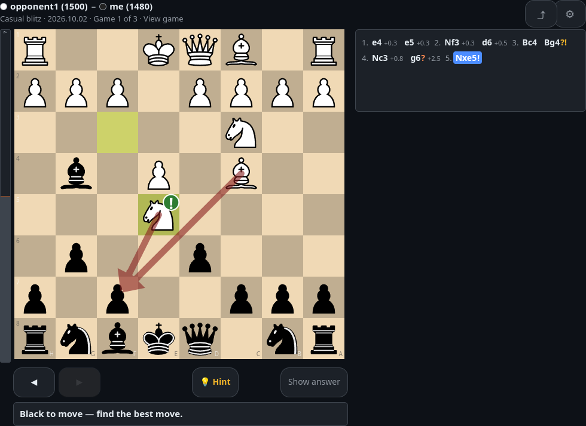
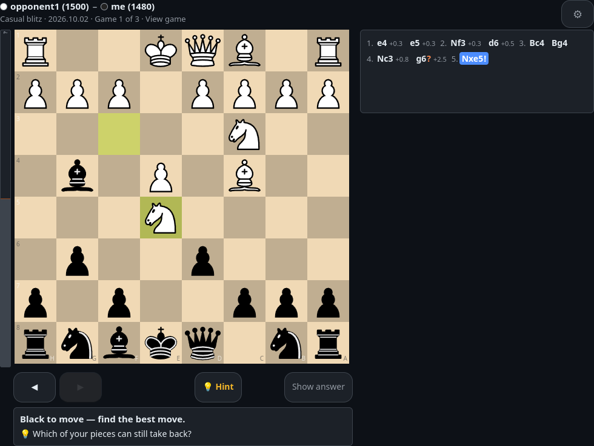
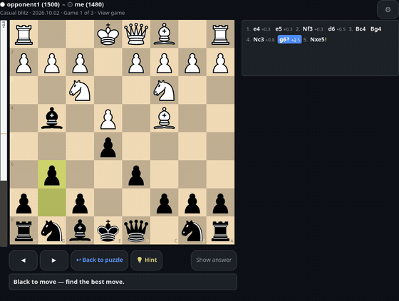
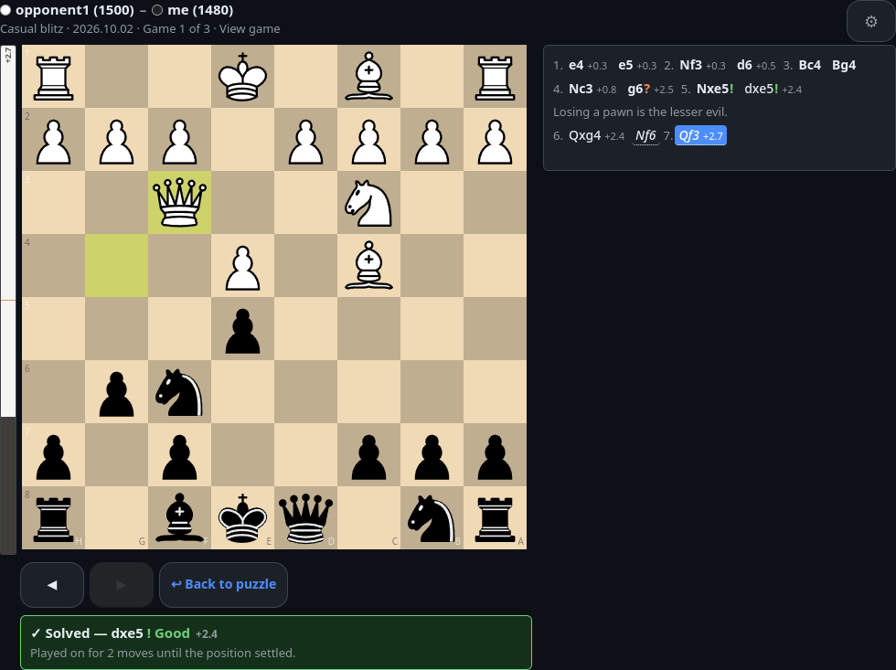

# knightly-review
Your nightly chess reps, made from your own games. knightly-review pulls your Lichess/Chess.com games, finds your mistakes with an engine, and turns the ones costing you the most wins into interactive Anki cards: openings, tactics and endgames.

## Install

You need [Anki](https://apps.ankiweb.net/) on a computer (Windows, macOS or Linux). Cards are made on the computer, and reach AnkiDroid, AnkiMobile and AnkiWeb through normal Anki sync.

1. Install the add-on: double-click `knightly_review.ankiaddon`, or in Anki use **Tools → Add-ons → Install from file…**. Restart Anki.
2. A welcome window opens. Enter your Lichess and/or Chess.com username.
3. Check that Stockfish was found (it's required). If it isn't installed, its window offers two ways to get it:

   | Your system | Install it yourself | Or let the add-on do it |
   |---|---|---|
   | Windows 10/11 | `winget install --id Stockfish.Stockfish -e` (the add-on can run it for you) | **Download Stockfish for me** |
   | macOS | `brew install stockfish` if you use Homebrew (the add-on can run it for you) | **Download Stockfish for me** |
   | Arch, Manjaro | `sudo pacman -S stockfish` | **Download Stockfish for me** |
   | Debian, Ubuntu, Mint | `sudo apt install stockfish` | **Download Stockfish for me** |
   | Fedora | `sudo dnf install stockfish` | **Download Stockfish for me** |
   | openSUSE | `sudo zypper install stockfish` | **Download Stockfish for me** |

   **Download Stockfish for me** fetches the official build from the Stockfish GitHub releases, checks it, and keeps it inside the add-on's folder. No admin rights needed.

   Stockfish searches every position to a fixed depth: 13 by default, which is quick. 20 or more gives better judgements if your computer can take it. Its hash table size (RAM) is in the same box.

   Optional: **Lc0** as a second engine (much faster with a graphics card; get it from [lczero.org](https://lczero.org/play/download/)). When it's on, Lc0 analyses each position after Stockfish, for as long as Stockfish took there. Lc0's judgement is used, except in mate positions, where Stockfish's is. Only Stockfish and Lc0 are supported.
4. Save. The first update fetches your recent games and analyses them in the background (a few minutes; Anki stays usable). New cards appear in the **Knightly Review** deck.

After that, updates run when Anki starts and every few hours while it's open. **Tools → Knightly Review → Update now** runs one right away. Lichess: logging in (optional, in Settings) makes downloads faster; your password stays on lichess.org. Chess.com refreshes its game lists only a few times a day, so new Chess.com games can take a few hours to show up.

## What it looks like

The card shows your game up to the mistake and asks for a better move. Right-click and drag on the board to draw your own arrows while you think; the card draws its own arrows too (the best move in green, your rejected move in red).




Get stuck and the hint button helps. Play the wrong move and the card shows the best one:

| Hint | A wrong move |
|---|---|
|  |  |

Play the right moves and the puzzle is solved:



The back lists the alternatives, each graded with its line, with arrows for your move and the best one:


With live play on (⚙ on any card), the puzzle goes on past the stored moves, against an engine, until it is settled:



| Card settings (⚙ on any card) | On a phone |
|---|---|
|  |  |

### In Anki's own windows

| Settings | Finding or installing Stockfish | Update progress |
|---|---|---|
|  |  |  |

These pictures come from real Anki and the sample games in `card/dev/samples.pgn`. They are regenerated by `node card/e2e/screenshots.mjs --anki` (see [card/e2e/README.md](card/e2e/README.md)); without `--anki` the card pictures come from a headless browser instead.

## Move grades (NAGs)

Every move on the back of a card has a grade, the standard chess annotation symbol (a NAG). The grade is how much win rate the move loses against the engine's best move. "Win rate" is the engine's expected score: wins plus half the draws, from its win/draw/loss estimate.

| Grade | Name | Meaning |
|---|---|---|
| `!!` | brilliant | the only good move, and it sacrifices material |
| `□` | only move | the only good move, and not a sacrifice |
| `!?` | interesting | a good move that gives up material while another good move keeps more |
| `!` | good | any other good move: within **Good move** (2 % by default) of the best |
| `?!` | inaccuracy | not a good move; loses up to 10 % |
| `?` | mistake | loses 10–20 % |
| `??` | blunder | loses more than 20 % |

- By default, `!!`, `□`, `!` and `!?` are accepted as answers; `?!`, `?` and `??` fail the puzzle. Change which ones count with `acceptNags` ([card/README.md](card/README.md#settings)).
- When the best move mates by force, a good move is one that keeps a forced mate, however long. A move that gives the mate up is `?!` at best, even if the engine still calls the position won. Turn on `strictMate` to accept only the fastest mate.
- A *sacrifice* is a move that, along the engine's line, ends at least 2 points of material (pawn 1, knight and bishop 3, rook 5, queen 9) below the line that keeps the most.
- The numbers beside moves (`+2.4`, `#3`) are the engine's eval from White's point of view; `#3` is mate in 3.

## Settings

There are two places for settings. **Tools → Knightly Review → Settings…** controls how cards are made, and is saved in Anki's add-on config. **⚙ on a card** controls how a card behaves while you review.

### Settings window (making the cards)

| Setting | Default | What it does |
|---|---|---|
| Lichess / Chess.com | empty | Whose games to fetch. Either can be empty. Logging in to Lichess (optional) makes downloads faster. |
| Look back | 90 days | How far back to fetch games. **All time** fetches everything; raising it later downloads the older games on the next update. |
| Stockfish: depth | 13 | Every position is searched to this depth. 20 or more gives better judgements, if your computer can take it. |
| Stockfish: threads, hash | half the cores, 64 MB | CPU threads and RAM for the engine. |
| Lc0 | off | Second engine. It analyses after Stockfish, and its judgement is used except in mate positions, where Stockfish's is. |
| Deck | Knightly Review | Where the new cards go. |
| New cards per update | 10 | An update stops after this many new cards. |
| Analysis per update | 10 min | …or after this much engine time (0 = until the cards are found). The next update carries on from there. |
| After the update | stop | **Keep analysing** deepens positions and confirms candidates in the background, so the next update adds cards right away. **Keep adding cards** goes on with no per-update limit. Both run the engine at full load (heat, fan, battery). |
| Cards | one note per game | How cards are grouped, see below. |
| By opening, card moves losing over | 2 % | By-opening mode: a move losing more than this becomes a card. By default every `?!`, `?` and `??`. |
| Opponents' mistakes | off | Also make cards from your opponents' mistakes, played from their side. |
| Update when Anki starts / every | on / 6 h | Automatic updates while Anki is open. |
| Good move: within | 2 % | A move this close to the best (in win rate) counts as a correct answer. |

### Study decks

After each update the add-on creates filtered decks under the main deck (`Knightly Review::Severity - Blunders`, `Phase - Endgame`, `Mate only`, `Piece - Knight`, `Random mix`, and one per motif, opening and time control). They start empty: open one and press **Rebuild** to study those cards, **Empty** to give them back. Turn this off with the *Study decks* checkbox in Settings, or `study_decks` in the config; **Tools → Knightly Review → Create study decks** makes them by hand.

Not in the window, but in the add-on's config (**Tools → Add-ons → Knightly Review → Config**): `time_classes` (which time controls to fetch), `rated_only`, and `min_loss` (default 10 %: in the per-game modes, a move you played must lose at least this much to become a card). See [addon/knightly_review/config.md](addon/knightly_review/config.md) for every key.

**Cards** (how they are grouped and ordered):
- **One note per game, newest first** (default): one note per game and phase (opening, middlegame, endgame, as Lichess splits them). Every move that loses at least `min_loss` becomes a card.
- **One note per game, biggest mistakes first:** the same notes, but mistakes from all games are ranked together: the win rate lost, weighted by the result (your move in a game you didn't win counts most), and more for positions you reach again and again.
- **By opening and move:** one note per opening, your colour and move number, e.g. *Sicilian Defense (Black), move 5…*. Openings that cost you the most points come first (4 per loss, 2 per draw, 1 per win), gone through move by move from the start. The new cards are put at the front of Anki's new-card queue in that order.
- **By tactical motif:** one note per motif of the best move (fork, pin, skewer, back-rank mate, …), with puzzles from any game, up to 10 cards a note.

### Card settings (⚙ on a card)

These change how a card plays, per device or, with **Save for all devices**, for every device that syncs. The main ones:

| Setting | Default | What it does |
|---|---|---|
| `intro` | `lastMove` | Animate the opponent's last move, or replay the whole game (`fullGame`). |
| `afterAnswer` | `flip` | After the puzzle: show the back, stay on the front, or flip and then grade by itself (`grade`: Good if solved, Hard with hints, Again if failed). |
| `hints` | on | The Hint button: a text hint if the card has one, then the piece to move. |
| `live` | off | Keep playing past the stored moves against an engine, until mate, a draw or a quiet position. |
| `goodMove` | 2 | Live play: how much win rate a move may lose and still count. |
| `timed`, `timeLimit`, `timeAffects` | off, 30 s, nothing | A clock while you think. Out of time can do nothing, fail the card, or grade a slow solve lower. |
| `showEval` | on | The eval bar and numbers. |

All of them are listed in [card/README.md](card/README.md#settings).

## Tags

Every note is tagged so you can search the browser or build filtered decks, for example `tag:knightly::phase::endgame` or `tag:knightly::severity::blunder`. Updates replace a note's `knightly::` tags and keep your own.

| Tag | Meaning |
|---|---|
| `knightly` | every note made by the add-on |
| `knightly::phase::opening` / `middlegame` / `endgame` | the game phase of the mistake |
| `knightly::site::lichess` / `chesscom` | where the game was played |
| `knightly::color::white` / `black` | the side you played |
| `knightly::time::blitz`, `rapid`, … | the time control |
| `knightly::result::win` / `draw` / `loss` | how the game ended for you |
| `knightly::rated` / `knightly::casual` | rated or casual |
| `knightly::opening::<family>` | the opening, e.g. `sicilian-defense` |
| `knightly::severity::blunder` / `mistake` / `inaccuracy` | the grade of the move you played: `??`, `?` or `?!` |
| `knightly::motif::<motif>` | a tactical motif of the best move, e.g. `fork`, `pin`, `back-rank-mate`, `mate-in-2` |
| `knightly::piece::<piece>` | the piece that plays the best move: `pawn`, `knight`, `bishop`, `rook`, `queen`, `king` |
| `knightly::opponent` | the card comes from an opponent's mistake |

Each note also has one **key tag** that lets the next update find it again: `knightly::game::<site>-<id>::<phase>`, `knightly::by-opening::<colour>-<opening>::ply-<n>` or `knightly::by-motif::<motif>::n-<number>`. Leave these alone, or the next update makes the note again. A note with several cards or games has every tag that any of them has.

## How it works

```
core/      Python package `knightly`: fetch games, analyse, pick mistakes, write notes (no Anki imports)
addon/     the Anki add-on: settings, scheduling, writing notes; bundles core/ and python-chess
card/      the interactive card (TypeScript), built into one media file
```

- Games come from the Lichess API (incremental, one request at a time) and the Chess.com archive API (each finished month downloaded once; the current month re-checked with ETags).
- Every position is analysed by Stockfish (fixed depth), and by Lc0 too when it's on (fixed time), always with win/draw/loss output (`UCI_ShowWDL`). "Win rate" everywhere means the engine's expected score: wins + draws / 2. Evals are cached in a SQLite file, shared by threads and processes.
- A move becomes a card when it loses at least 10 % win rate. This is deliberate: the engine's WDL treats a position about 2 pawns up or down as already decided, so mistakes there barely register. Cards come from the moments where the result was still in play. Mistakes in games you didn't win, and positions you reach again and again, rank first. Each pick is checked again with a deeper multi-line analysis, which grades every candidate move (`!!`, `□`, `!?`, `!`, `?!`, `?`, `??`; see [card/README.md](card/README.md)) and gives the accepted alternatives on the back of the card.
- One note per game and phase (opening, middlegame, endgame, split as Lichess does), one card per mistake. Notes are tagged by phase, site, colour, time control, result, opening and how bad the mistake was (`knightly::…`). Card numbers stay stable when a game gets more cards later, so review history is kept. Optionally (off by default), your opponents' mistakes become cards too, played from their side.
- Optionally (off by default; ⚙ on any card), cards don't stop after one move: past the stored first move and reply, a live engine keeps the position going until mate, a draw or a quiet position. On desktop that's your Stockfish/Lc0 through the add-on; on phones and AnkiWeb, a small built-in Stockfish that syncs with the cards (1.8 MB).

The add-on bundles only pure-Python code (python-chess and the core), so one file installs on every OS. Heavier work planned for later (personal engines that need ML libraries) will run in a separate helper process with its own Python, not inside Anki.

See [card/README.md](card/README.md) for the card and its PGN format, [addon/README.md](addon/README.md) for building the add-on, and [core/README.md](core/README.md) for the command line.

## Licence

GNU Affero General Public License v3 or later (see `LICENSE`). The motif tagger in `core/knightly/cook.py` and `cookutil.py` is ported from [lichess-puzzler](https://github.com/ornicar/lichess-puzzler) (AGPL-3.0).
